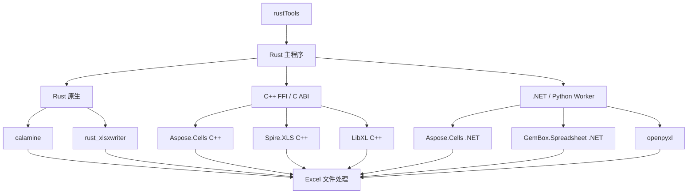

# 阶段五：综合架构建议

状态：阶段一至五已取得第一轮实测，生产架构建议仍为“按操作选引擎，暂不迁移”。性能样本规模有限，商用许可未提供，且麒麟 V10/UOS V20 尚未实机测试。

## 用户提供的目标分层图

下图按用户给出的功能边界整理。它是候选方案图；图中存在的引擎不代表当前可在生产启用。实际部署路由必须通过 glibc、能力、保真、桥接、授权和目标系统验收门禁。

## 证据驱动的建议

### 继续使用 Rust 作为主程序

读取、任务调度、批处理、日志和新建 XLSX 继续沿现有 Rust 能力实施。当前没有证据显示把这些职责迁到商用 SDK 会带来足够业务收益。

### 既有工作簿修改暂保留当前隔离 Python 路由

当前 Rust→openpyxl 生产实现已有批量 ExcelEditPlan、候选文件验证、源快照/提交保护、进程树约束等具体代码和测试记录。此次 Python 原型在 Windows 证明批量 JSON 文件交换可用，但不构成正式部署性能基准。Aspose/GemBox 的能力测试也出现评估许可污染或页眉保真差异，所以没有依据替换当前 openpyxl。

### .NET Worker 是通过部署门槛的候选，不是现成替换项

Aspose.Cells .NET 在 Rocky 8.9/glibc 2.28 目录式 self-contained 离线运行通过，指定公式集也通过自身 API 回算和保存回读；同一小型公式集在 Excel COM、BetterOffice 与商用引擎期望结果上一致。Rust→常驻 Worker 批量 10 万行额外协议/JSON 处理约 91 ms。但 Aspose 试用版保存会加入 Evaluation Warning 工作表，且公式对照仅覆盖 10 个合成公式，没有生产许可保真和 10k–100k 公式性能证据，因此不能据此替换现有计算或修改路线。

GemBox .NET 同样通过 glibc 和离线 smoke，但免费版 150 行上限挡住大文件测试，且能力阶段发现原始页眉语义未保留。未购买正式版本前不作为 15 万/100 万行候选结论。

### C++ FFI 仅适合明确通过门禁的 SDK

本轮 Aspose.Cells C++、Spire.XLS C++ 需要高于目标的 GLIBC 版本，禁止继续用改系统 glibc 的方式绕过。已通过的 LibXL C++ 有可运行的 C ABI wrapper，适合按 C ABI、不透明句柄、批量请求包装；但评估许可限制读数据，本轮没有原生 XLS→XLSX 转换或公式计算能力，百万行样本峰值 RSS 约 3.1 GiB。暂不建议把它用于通用复杂编辑、公式或格式转换。

## 候选路线取舍

| 路线 | 当前判断 | 主要依据 |
|---|---|---|
| 纯 Rust | 不切换为“完全纯 Rust” | 当前业务仍使用隔离 openpyxl 完成复杂既有 XLSX 修改；本轮没有完成相同业务集的 Rust 原生等价对照。 |
| Rust + C++ | 只保留 LibXL 的受限专项候选；Aspose C++/Spire C++ 淘汰于当前 glibc 基线 | LibXL C ABI 实测能工作；但无公式计算、无原生 XLS→XLSX，容量内存较高。 |
| Rust + .NET | 值得作为将来公式/复杂工作簿专项候选，不进生产 | Aspose .NET 兼容且可自包含，Worker 桥接损耗小；缺授权版保真/正确率对照，GemBox 大型场景被许可证阻断。 |
| Rust + Python | 维持现有按能力路由 | 生产实现已经提供隔离、批量、验证与安全提交；本轮没有证据表明换 SDK 能安全覆盖这些行为。 |

## 当前不建议替换的路径

- BetterOffice：同一 10 公式合成集的 Excel COM 正确性参照已完成；正确率/时间通过该样本，全面替换状态仍 `NOT_TESTED`。没有 10k–100k 公式性能矩阵或复杂真实公式覆盖。
- openpyxl：替换状态 `NOT_TESTED`。没有同环境同文件的完整修改流程对照；这次 Python 原型只是传输和追加样例。
- Excel COM XLS 转换：常驻 Excel COM 同机基准已对 8 个合成 XLS 执行 3 轮；Aspose/GemBox 在此小样本的另存耗时较低，但 Aspose 试用版多出警告工作表，GemBox 样本只有 100 行。是否替换生产 COM 路由仍 `NOT_TESTED`，需正式许可及业务样本保真复测。LibXL 的样例转换为重建，不能作为 COM 转换的替代比较。
- 真实业务公式、15 万行真实样本、100 万行多工作表/复杂格式、XLSB、Kylin V10/UOS V20 均未充分验证。

## 继续决策所需的下一组证据

1. Aspose、GemBox、LibXL 的正式许可证与可分发组件清单；取得授权版后重复保真/容量测试。
2. 用实际脱敏业务样本补充公式集和复杂 XLS/XLSX 保真，并使用 Windows Excel COM 为公式结果参照。
3. 对 BetterOffice 完成 10k–100k 公式负载；对 openpyxl 完成同主机完整修改流程性能对照。
4. 在麒麟 V10 和 UOS V20 实机离线安装并运行自包含 worker / deb。
5. 确认真实部署机器可承受 Aspose 约 2.1 GiB 和 LibXL 约 3.1 GiB 的本次百万行峰值，并测试并发预算。

## 最终建议

当前采用 **Rust 主程序 + 现有 Python/openpyxl 隔离修改 Worker**，继续按操作选引擎；Rust 原生路径承担普通读取与新建。把 **Aspose .NET 常驻 Worker**保留为授权后复测的公式/复杂文件候选；把 **LibXL C++/C ABI**保留为可能的旧 XLS 修改候选。暂不接入两款 glibc 不兼容的 C++ SDK，也不替换 BetterOffice、openpyxl 或 Excel COM 转换。

这是一项基于已完成阶段和当前试用许可证据的暂行建议，不是生产架构迁移批准。阶段 2 中评估版的限制必须在可采购正式许可后重新评估。
